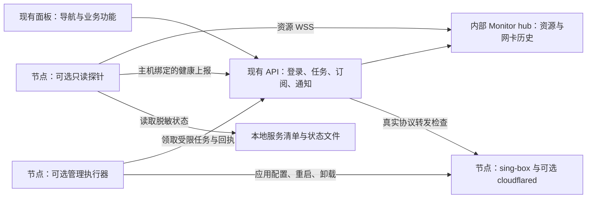

> 历史记录：独立 Monitor 模块已按用户要求删除并保留备份，当前请参阅 [移除说明](monitor-removal.md)。

# Monitor 资源看板与独立安装方案评估

日期：2026-10-23。本文保留实施前评估；后续改造已完成，实际变更与验收见 [实施记录](monitor-rollout-report.md)。

## 1. 结论

可以适配。推荐采用 **现有面板 + Monitor 资源服务 + 扩展后的轻量探针**，保留现有三协议、订阅、任务、Telegram 和面板侧真实转发检测。

新增节点默认只安装协议；资源探针单独勾选、单独安装和卸载。同一服务器只运行一份探针，可以关联多个协议节点。页面改成左侧导航切换视图，右侧只呈现当前模块。

精简 sing-box 已有本机三协议对照测试，适合进入安装器试点。保留原版通道和每台服务器一份受控回滚备份；ARM 实机、真实 Argo 链路和目标系统验证完成前，不向全部机器默认推广。

**需要单独处理的关键问题：旧节点脚本不仅采集数据，还执行远程任务和自动修复。原版 Monitor agent 没有这些执行能力。** 因此“安装资源探针”和“允许远程管理”应当是两项明确能力，不能删除旧脚本后宣称所有管理功能仍然可用。

## 2. 已核查的依据

本次阅读了当前项目安装、agent、资源、流量及探测实现，并核查 Monitor 三个仓库：

| 项目 | 本次源码版本 / 提交 | 用途 |
| --- | --- | --- |
| Monitor hub | Cargo 1.5.0 / `e8b3cfea64f10c908bfc5325bab45d3ea0b02a0b` | 采集连接、资源历史、API |
| Monitor agent | Cargo 1.2.2 / `e240c66dc99d3106928c41973cb3655dc74a8461` | 节点端采集器 |
| Monitor 默认主题 | package 1.4.1 / `94c5fe39451381bdabb5694bfde997a3732498ce` | 卡片、详情、图表参考 |

上游支持 Linux amd64、arm64，安装方式覆盖 systemd 和 OpenRC，适合本项目的 Debian、Alpine 和 NAT 服务器。32 位 ARM 不在现成发布范围内，不能把“ARM 支持”泛化到所有架构。[上游接入说明](https://monitor-document.pages.dev/install/agent)

探针主动建立带身份认证的 WebSocket，节点无需新增公网监听端口；资源历史留在 hub。上游协议包含资源上报及延迟任务，没有任意命令执行接口。[上游架构说明](https://monitor-document.pages.dev/dev/architecture)

源码核查位置：hub 的 `src/auth.rs`、`src/api.rs`、`src/agent_ws.rs`、`src/db.rs`；agent 的采集器及发布工作流；主题的 `src/App.tsx`、`src/lib/api.ts`。三个项目采用 MIT 许可，复用代码时保留许可和归属声明。

## 3. 核心精简与原方式备份

### 已有测试能证明什么

此前在本机 amd64、相同 sing-box v1.14.3 和 Go 编译器条件下，三轮传输测试结果如下。只统计协议服务端核心，不含 cloudflared 或监控探针。

| 协议 | 标准版传输中 RSS | 精简版传输中 RSS | 降幅 |
| --- | ---: | ---: | ---: |
| VLESS-WS | 55.29 MiB | 35.47 MiB | 35.8% |
| Reality Vision | 56.91 MiB | 37.67 MiB | 33.8% |
| Hysteria2 | 60.33 MiB | 40.33 MiB | 33.2% |

HTTPS 双向传输内容、UDP 回显及停服后请求失败均已验证。VLESS-WS 项没有经过 Cloudflare 公网隧道。线上版本、负载和内存限制不同，不能承诺每台服务器都节省约 20 MiB。完整条件及原始数据见 [核心内存测试报告](core-memory-benchmark.md)。

### 安装器适配

1. 增加“精简版 / 原版”两个固定版本通道，记录版本、架构、编译标签、校验值和安装来源。精简版仍使用 sing-box，先不重写三协议核心。
2. 在构建机产出 Linux amd64、arm64 静态文件，节点只下载验证，不安装 Go/Rust 编译环境。保留三协议必需能力；先用现有完整配置做 `sing-box check`，遇到未包含的功能明确使用原版，不能删配置来迁就精简版。
3. 先试点 amd64 的 Alpine、Debian，再验证 arm64 实机。通过平台矩阵的组合才把精简版设为新安装默认值；其他组合继续使用原版。
4. 在替换前保存一份上一已知可用的核心文件、校验清单及必要的服务/配置恢复资料，权限限 root。保留原版安装逻辑和版本资产，不只备份一个脚本链接。
5. 新文件预检后原子替换，重启并验证本地服务和面板真实转发。失败恢复原核心；回滚前比对配置修订，避免覆盖期间用户的新修改。校验不匹配时停止自动回滚并给出恢复命令。
6. 同一主机的多个入站可能共用一个核心，升级和回滚必须按主机串行，验证所有受影响节点。重启会短暂影响连接，不能作为无中断升级承诺。

备份范围仅限本次核心/安装方式回退，默认每台保留一个回滚槽，不生成无限快照或把全站数据库、凭据另行打包。回退“核心文件”和回退“整套配置”是不同操作。节点端精简版也不自动替换面板用于流媒体检测等任务的客户端核心。

## 4. 目标架构

推荐保留 Monitor hub 的资源采集和存储模型，作为本服务器上的内部服务运行。本项目继续管理节点、订阅、流量配额、通知与任务，避免维护两套业务数据。

需要增加 `hosts` 主机表及 `nodes.host_id`：资源属于主机，协议属于节点。一台服务器部署三个协议，资源看板只出现一台主机，其详情列出三个服务。使用随机主机 ID 和受控绑定流程，不以 IP、DDNS 解析结果或相同 hostname 自动合并。探针观察到 IP 变化时，只更新观测信息，不覆盖订阅里的 DDNS 地址。

### 认证与接入不是直接反代即可

当前 hub 管理 API 使用自己的登录会话，没有可直接当作本项目共享登录使用的服务令牌接口；两边也都有 `/api/nodes`。不能将 hub 根路径直接暴露给现有页面。

建议为 hub 维护范围较小的集成补丁：增加仅供内部调用、权限限定的服务认证入口，覆盖主机登记、令牌轮换、删除及资源读取；通过本项目 `/api/monitor/*` 适配。浏览器继续使用本项目登录，内部令牌不进入前端；不要模拟管理员 Cookie 或直接写 hub 数据库。

关闭 hub 默认公开状态页。外网仅开放探针所需的认证连接路径及受控安装资源；管理 API 只在内部网络可达。资源面板的数据接口与实时连接均校验当前登录和可见范围。

探针健康扩展采用独立的低频 HTTPS 上报到本项目，不把私有健康字段混进 hub 公开资源协议。资源和健康使用不同用途的凭证，凭证绑定主机，健康端点校验关联节点范围。这样只需扩展 agent 的采集/上报模块，不必同时改写 hub 全套历史聚合。

## 5. 左侧导航和资源页面

改为独立模块视图：概览、配置部署、已部署节点、部署任务、订阅管理、资源看板、流量与通知。点击导航只显示相应内容；概览保留摘要卡片，不再拼接全部模块。

使用地址 hash 或同等路由机制保留刷新、深链接、浏览器前进后退；旧模块锚点做兼容映射。非活动页面隐藏并退出键盘焦点顺序，暂停其图表刷新和实时订阅，切换回来再恢复。后台部署任务与通知调度继续运行，不受浏览器当前页面影响。

当前安装表单编辑内容、列表过滤条件和展开状态在切换后保留。模块级折叠不再需要，节点/任务的单条详情仍可按需展开。手机端点击后关闭侧栏，焦点移到当前标题。

资源页面复用 Monitor 默认主题中的主机卡片、资源条、历史曲线和分组方式，融入现有 shadcn 配色及导航。主题是 React，当前页面主要为原生 JavaScript，建议单独构建资源视图组件，通过统一 API 适配后挂载；改掉主题自带的根路由、登录跳转和全局样式，避免覆盖整个站点。[主题源码](https://github.com/monitor-probe/monitor-theme-default)

主机卡片显示地区、名称、在线/数据过期、CPU、内存、磁盘、上下行速率；详情显示历史、核心/隧道进程内存及关联协议健康。图表保留鼠标悬停和触摸提示。主机网卡用量与协议用量明确标注口径，资源页不重复提供订阅管理入口。

## 6. 两套独立安装脚本

### A. 协议安装

生成独立的协议安装命令，选择 VLESS-WS Argo、Reality Vision 或 Hysteria2，保留各自端口及协议参数。Argo 保留临时/固定隧道选择。

默认不安装资源探针，也不暗中启动旧的一分钟巡检脚本。安装器负责依赖、协议配置、服务启动及一次性结果回传；回传失败可有限重试或输出手动同步命令，不能因面板临时不可达反复重装。正常退出后没有安装器常驻进程。

安装器写入一份专用的脱敏服务清单，供之后安装探针时识别服务；包含节点 ID、协议类型、本地端口、服务名、配置修订等，不含 UUID、私钥、Cloudflare 凭据或订阅链接。

### B. 资源探针安装

部署页面增加“同时安装资源探针”，新建时默认不勾选；已有主机探针可直接关联，无需重复安装。即使勾选，仍保留两条可独立执行的安装/卸载命令和独立结果。协议成功、探针失败时显示部分完成，协议继续工作。

探针按主机安装，使用独立目录、服务、凭证和更新通道。资源每 5–10 秒采样上报，服务检查每 30–60 秒，重连退避；直接读取系统信息，不每秒启动 shell、curl、jq 子进程，不在节点存图表历史。

扩展后的 agent 需要本项目自己的固定版本、校验和签名发布流程，不能继续依赖上游签名验证来认证我们修改过的文件。保留上游版本与本项目扩展版本两项信息。

### 可选远程管理

在高级选项中单独呈现“允许面板远程修改与修复”。启用后安装受限管理执行器；它是探针安装包内的独立组件，职责和权限单独列明，不伪装成只读采集。

现有 root 任务能力分阶段迁移：固定操作类型、修订号、签名/摘要校验、超时、主机互斥和冷却，避免将普通资源凭证扩大为 root 命令权限。只读探针不直接执行 hub 下发的 shell。执行器可采用按需启动/定时领取方式，最终内存收益以含子进程峰值的测试为准。

| 能力 | 仅协议 | 协议 + 只读探针 | 再启用管理执行器 |
| --- | --- | --- | --- |
| 节点链接、订阅导出 | 支持 | 支持 | 支持 |
| 面板真实转发检查 | 支持，需先解耦现有调度 | 支持 | 支持 |
| CPU/内存/主机心跳 | 未启用 | 支持 | 支持 |
| 本地服务状态与进程内存 | 未启用 | 扩展后支持 | 支持 |
| 面板修改监听端口/远程卸载 | 提供手动命令 | 提供手动命令 | 支持 |
| 面板触发重启/自动修复 | 不提供 | 不提供 | 支持 |
| 临时隧道变化自动同步 | 无持续上报，不能保证 | 有状态来源时可同步 | 可修复并同步 |
| 协议流量/订阅用量更新 | 默认未启用 | 另需计数采集组件 | 可选启用计数组件 |

“没有探针”应显示“未启用监控”，不能显示“主机离线”。系统服务本身的崩溃重启与面板自动修复分开描述。临时隧道在无持续状态上报模式下改变域名，面板不会凭空知道新域名；界面需要明确提示这一限制。

## 7. 心跳、转发、修复如何迁移

| 检测/动作 | 建议位置 | 判断边界 |
| --- | --- | --- |
| 主机在线、资源采样 | Monitor 探针与 hub | 连接在线不等于资源样本新鲜，两者分别显示 |
| sing-box/cloudflared 存活、RSS | 探针扩展 | 只读受控服务状态，权限不足显示未知 |
| 本地监听与 WS 响应 | 探针扩展 | 证明本地入口，不证明公网或完整代理可用 |
| Argo 域名与公网可达信息 | 探针扩展 + 脱敏状态发布 | 域名变更需节点修订校验，再由面板验证后发布 |
| 三协议真实转发 | 本服务器 | 通过协议发起小流量请求，含连接/握手/转发结果 |
| 流媒体与 AI 服务解锁 | 本服务器 | 复用已有节点出站检测，控制并发和频率 |
| 重建、修改、卸载 | 可选管理执行器 | 有界操作，结果回执，失败保留可回滚状态 |
| Telegram 告警与汇总 | 本服务器 | 去重、延迟阈值、恢复通知、维护窗口 |

当前 `agent.py` 的外部探测依赖已绑定 agent 且心跳新鲜，结果关联 `applied_revision`。必须改成按有效节点配置独立调度，用配置修订/链接摘要防止旧结果覆盖新配置。否则“只安装协议”的节点无法自动测活，探针掉线时外部检查也会被错误停止。

建议外部检查保留约 5 分钟周期和并发上限；手动检查可立即触发。主机心跳沿用可配置的 180 秒级阈值，和服务失败、协议转发失败分开告警。hub 故障时先报“采集服务不可用”，不要将全部主机立即判死并触发批量重启。

读取 root 专属配置、nftables 计数或受限日志可能需要权限。优先由安装/管理组件发布脱敏状态文件，探针只读；确实需要特权时用固定功能的小型本地采集辅助程序，不能为方便而让整个资源探针获得无限 root 权限。

## 8. 流量口径与轻量化

保留两种统计：Monitor 记录主机网卡用量；现有 nftables 记录协议端口用量，供节点汇总及订阅用量使用。网卡还包含管理、隧道和其他业务数据，不能直接分摊到每个节点，更不能按同机节点数量重复计入订阅。

探针可读取可选的低频特权计数采集组件输出，上报端口计数及 epoch；内核继续计数，节点不运行数据库。主机网卡与端口计数各用自己的重置标识、基线和历史表。旧、新上报器同时运行时只允许一个计费来源，切换时保留边界和去重记录。

上游允许指定统计网卡；NAT/LXC、桥接和转发机器需验证默认网卡选择。资源页保留手工指定入口。断连、重启造成的历史缺口按实际可恢复范围呈现，不能伪造逐日用量。[上游流量口径](https://monitor-document.pages.dev/config/traffic)

现有订阅用量是关联节点端口的汇总，并不等于每个订阅用户的独立消耗。未启用协议计数时显示“用量未启用/数据过期”，历史值保留，不能将零当作实时用量。hub 统计时区明确设为 UTC，与现有汇总对齐；图表显示时区标签。

上游报告 agent 常驻约 2 MiB、hub 空闲约 7 MiB，但测试版本为 agent 1.2.1 / hub 1.4.1，**不是本次扩展版的实测值**。[上游性能报告](https://monitor-document.pages.dev/reference/performance)

当前 cron 巡检在退出后不保有自身进程；换成常驻探针可能增加数 MiB 的持续内存，同时减少周期性 shell 子进程开销。整套是否更省要同时测核心、cloudflared、探针及辅助程序，不能直接用“精简核心节省量减上游 2 MiB”作生产结论。

试点目标：探针常态 RSS 尽量控制在 5 MiB 左右，作为待验证目标而非承诺；采集低频且有超时，进程数、网络重连和日志有上限。NAT/LXC 还要检查 cgroup 配额与 `/proc` 主机值的差异，页面明确数据范围。

## 9. 实施顺序与验收

| 阶段 | 交付 | 完成门槛 |
| --- | --- | --- |
| 1 | 独立模块视图、精简/原版安装通道与单份回滚 | 手机/桌面路由正常；版本预检及失败恢复可验证 |
| 2 | 主机模型、协议/探针两套安装命令、能力状态 | 无探针仍可部署、订阅和外部测活；安装可重复执行 |
| 3 | 内部 hub、认证适配、Monitor 资源视图 | 无第二次登录、无公开数据泄露；同机多节点仅一份资源 |
| 4 | 探针健康扩展、计数采集、可选管理执行器 | 状态/告警/任务职责明确，原有管理能力逐项通过 |
| 5 | 小范围迁移与整套内存测试 | 两种 OS、两种架构及三协议通过后再逐批切换 |

关键验收用例：

- 三协议分别验证 TCP/UDP、真实传输及停服失败；Argo 覆盖固定/临时隧道；Alpine/OpenRC、Debian/systemd、amd64/arm64 均有实际运行验证。未覆盖的组合标记未验证。
- 观察空闲、活跃、断网重连、重启、至少 24 小时运行后的 RSS/PSS、CPU 和日志增长；统计辅助进程峰值。ARM 不能只靠交叉编译成功判定通过。
- 探针停止时协议持续可用；外部探测继续；hub 中断不触发全体服务重建；恢复通知去重。
- DDNS 地址变化、NAT、IPv6、多个节点同一主机、安装失败重试、面板暂时离线均可正确识别。
- 修改配置期间旧探测结果不覆盖新节点；共享核心升级验证全部入站；核心回滚不回退新业务配置或订阅身份。
- 卸载探针不卸载协议；删除一个协议不删除同机其他节点或主机探针；删除最后一个协议仍保留独立主机监控，用户可另行卸载探针。
- 强制删除只移除所选面板对象及撤销对应凭证，明确不保证离线机器清理。共享主机凭证不能因删除其中一个协议而一并撤销。
- 迁移不改变 UUID、端口、固定隧道、订阅链接和现有流量历史；旧资源历史按原口径保留并标明切换时间，不伪装成高频 Monitor 历史。

旧 agent 在新路径验收前保留，但监控来源和管理来源独立切换，禁止新旧两套同时修复同一节点。新探针稳定后才停旧资源采样，管理执行器接管后才删除旧任务领取逻辑。

## 10. 本轮交付范围

已完成源码与现有流程核查，复用了此前核心内存实测，形成上述可分阶段实施的方案。本轮没有部署 Monitor、替换线上核心、迁移节点或同步 GitHub；扩展探针内存、ARM 运行情况和整套性能仍待实施阶段实测。

参考：[Monitor 项目](https://github.com/monitor-probe/monitor)、[agent 源码](https://github.com/monitor-probe/agent)、[默认主题](https://github.com/monitor-probe/monitor-theme-default)、[已有资源与协议库评估](resources-and-core-assessment.md)。
